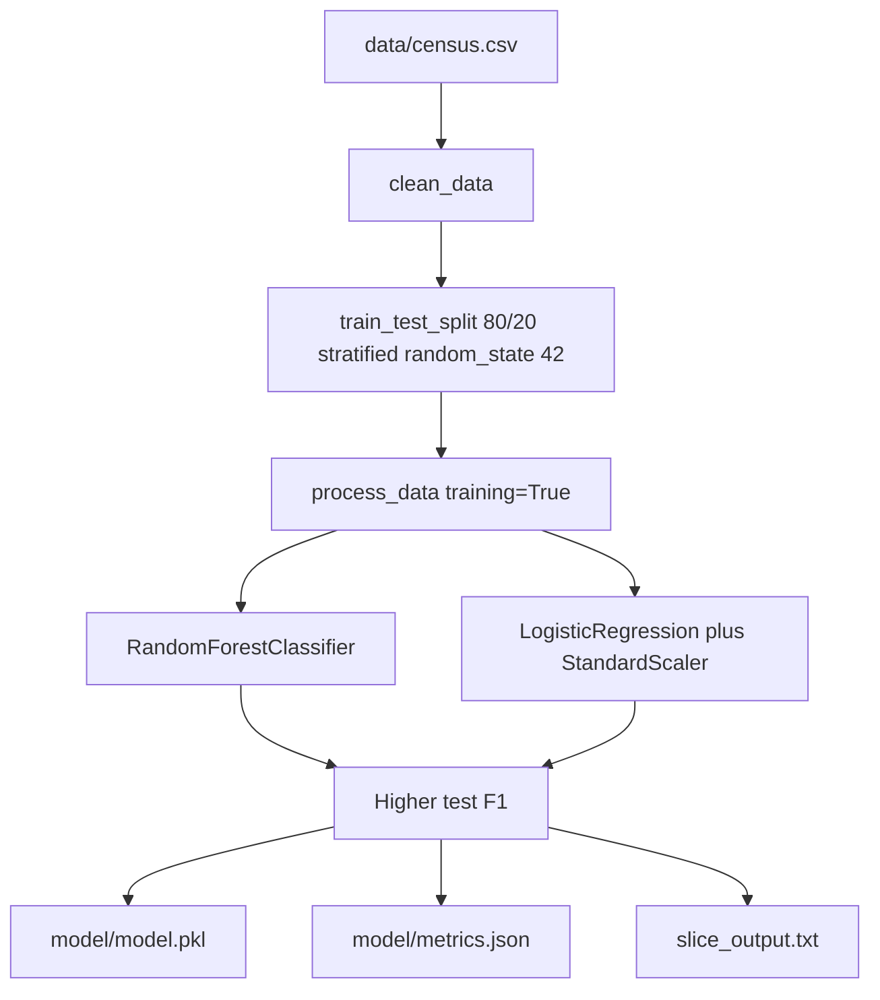
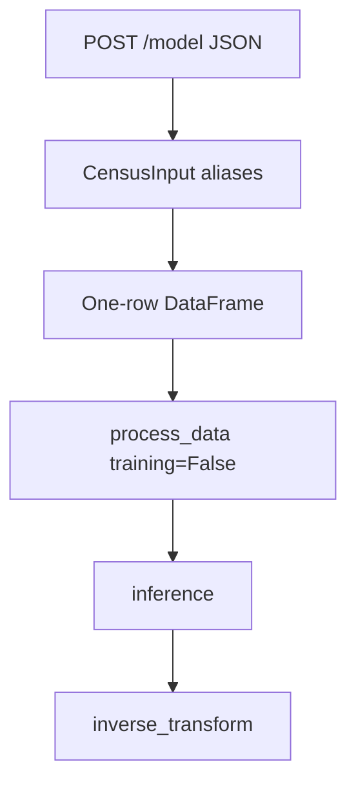
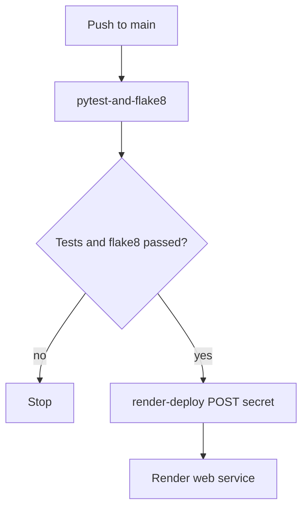

# Architecture

Census income classifier served by FastAPI. The saved model predicts `<=50K` or `>50K` from one Census row. Training, the HTTP API, and the gated Render deploy are three separate paths that share `model/model.pkl`.

Repository: https://github.com/mynamerahulkumar/UcityMachine_learning_model_fastapi.git

The pass/fail command list is in [startup.md](startup.md). This file explains the code and gives the same local examples with the expected results.

## Training path

`python starter/train_model.py` reads `data/census.csv` in memory. It does not edit the CSV.



`clean_data` in [starter/ml/data.py](starter/ml/data.py) copies the frame, strips text fields, and drops rows where a categorical value is `?`. That removes 2,399 of 32,561 rows and leaves 30,162. The split is 24,129 training rows and 6,033 test rows.

`process_data` one-hot encodes the categorical columns with `handle_unknown="ignore"` and binarizes `salary`. Numeric columns are concatenated after the encoder output. They are not scaled for the random forest. `StandardScaler` is fit only inside the logistic regression pipeline, on the already encoded matrix.

Both models are scored on the same test rows. The higher F1 is saved. A tie would keep the forest. The current winner is `RandomForestClassifier`.

| Model | Accuracy | Precision | Recall | F1 |
|---|---|---|---|---|
| Random forest | 0.8497 | 0.7308 | 0.6272 | 0.6750 |
| Logistic regression | 0.8472 | 0.7339 | 0.6059 | 0.6637 |

Precision, recall, and F1 use the positive class `>50K`. Full-precision values are in `model/metrics.json`. The four-decimal figures match [model_card.md](model_card.md).

Slice scoring runs on the test split for every `education` value and writes [slice_output.txt](slice_output.txt). A row with `n` under 30 is marked `small_sample`. `zero_division=1` fills a metric when a slice has no positive labels or no positive predictions. `1st-4th` (27 rows, no `>50K` labels) reports 1.0000 for that reason. `HS-grad` (2,023 rows) has F1 0.4750. `Bachelors` (1,010 rows) has F1 0.7565.

## What `model/model.pkl` contains

`save_model` writes one joblib object:

| Key | Role |
|---|---|
| `model` | Fitted `RandomForestClassifier` (`random_state=42`) |
| `encoder` | Fitted `OneHotEncoder` |
| `lb` | Fitted `LabelBinarizer`. `classes_` is `<=50K`, then `>50K` |
| `categorical_features` | Eight text columns, including hyphenated names |
| `feature_columns` | The 14 model inputs, in CSV order, without `salary` |
| `algorithm` | `RandomForestClassifier` |

The API loads this file once at startup. It does not train on boot. Paths are relative to [main.py](main.py).

## Request path



[main.py](main.py) defines `CensusInput`. Python fields cannot contain hyphens, so the schema uses aliases and `model_dump(by_alias=True)`. The JSON body must use the CSV names.

| JSON field | Python attribute |
|---|---|
| `education-num` | `education_num` |
| `marital-status` | `marital_status` |
| `capital-gain` | `capital_gain` |
| `capital-loss` | `capital_loss` |
| `hours-per-week` | `hours_per_week` |
| `native-country` | `native_country` |

`age`, `workclass`, `fnlgt`, `education`, `occupation`, `relationship`, `race`, and `sex` use the same name in JSON and in Python.

`predict` builds a one-row frame with `artifact["feature_columns"]`, calls `process_data(..., training=False)`, then `inference`. `lb.inverse_transform` turns the 0/1 prediction back into `<=50K` or `>50K`. An unknown category is ignored by the encoder and still returns a label. A missing field or a wrong type returns HTTP 422 before the model runs. A failure inside inference returns HTTP 400.

Routes:

| Method | Path | Body |
|---|---|---|
| GET | `/` | `{"message":"Welcome to the Census Income Prediction API"}` |
| GET | `/health` | `{"status":"ok"}` when the artifact is loaded |
| POST | `/model` | `{"prediction":"<=50K"}` or `{"prediction":">50K"}` |

Swagger is `http://127.0.0.1:8000/docs`. The Example Value on `POST /model` is the low-income payload below, and the schema lists the high-income payload as well. That page is `screenshots/example.png`.

## Deploy path



`.github/workflows/ci.yml` runs `pytest-and-flake8` on pushes and pull requests to `main`. `render-deploy` needs that job and runs only on a push to `main`. It POSTs `RENDER_DEPLOY_HOOK_URL` and does not print the URL. [render.yaml](render.yaml) sets `autoDeploy: false`. The start command is `uvicorn main:app --host 0.0.0.0 --port $PORT`. Setup steps are in [DEPLOYMENT.md](DEPLOYMENT.md). This repository has not been deployed.

## Code map

| File | What to read |
|---|---|
| [starter/ml/data.py](starter/ml/data.py) | `clean_data`, `process_data` |
| [starter/ml/model.py](starter/ml/model.py) | `train_model`, `inference`, `save_model`, `load_model`, `compute_model_metrics`, `evaluate_slices` |
| [starter/train_model.py](starter/train_model.py) | Comparison, artifact write, slice file |
| [main.py](main.py) | Pydantic models and the three routes |
| [tests/test_model.py](tests/test_model.py) | Train, save/load, inference, artifact keys |
| [tests/test_api.py](tests/test_api.py) | GET, both salary labels, 422 cases, unknown category |
| [request_live.py](request_live.py) | POST to a public URL. It rejects localhost |

`tests/test_api.py` uses the two payloads below. They were checked against this `model/model.pkl` before they were copied into the tests. Retraining with a different seed can change those labels and fail the tests.

## Step-by-step local test

Run these from the repository root. `python3` on this machine is 3.14. Use 3.13.

### 1. Environment

```bash
python3.13 -m venv .venv
source .venv/bin/activate
python -m pip install --upgrade pip
pip install -r requirements.txt
pip install -e .
```

### 2. Confirm the saved model without training

```bash
python - <<'PY'
import json
from pathlib import Path
from starter.ml.model import load_model

artifact = load_model(Path("model/model.pkl"))
metrics = json.loads(Path("model/metrics.json").read_text())
print(artifact["algorithm"])
print(metrics["training_samples"], metrics["test_samples"])
print(metrics["selected"])
PY
```

Expected:

```text
RandomForestClassifier
24129 6033
{'accuracy': 0.8496602022211172, 'precision': 0.730799069045772, 'recall': 0.6271637816245007, 'f1': 0.675026872088857}
```

Train only if `model/model.pkl` is missing:

```bash
python starter/train_model.py
```

After a retrain, check both API payloads against the new file before trusting `tests/test_api.py`.

### 3. Start the API

```bash
uvicorn main:app --host 127.0.0.1 --port 8000
```

Leave that process running. Use a second terminal for the next calls. The process exits at startup if `model/model.pkl` is missing.

### 4. Welcome and health

```bash
curl -sS -D - http://127.0.0.1:8000/ -o /tmp/census_get.json
echo
cat /tmp/census_get.json
echo
curl -sS http://127.0.0.1:8000/health
echo
```

Expect HTTP 200 and:

```json
{"message":"Welcome to the Census Income Prediction API"}
```

```json
{"status":"ok"}
```

### 5. Predict `<=50K`

```bash
curl -sS -D - http://127.0.0.1:8000/model \
  -H 'Content-Type: application/json' \
  -d '{"age":27,"workclass":"Private","fnlgt":245661,"education":"HS-grad","education-num":9,"marital-status":"Separated","occupation":"Machine-op-inspct","relationship":"Own-child","race":"White","sex":"Female","capital-gain":0,"capital-loss":0,"hours-per-week":40,"native-country":"United-States"}'
echo
```

Expect HTTP 200 and `{"prediction":"<=50K"}`.

### 6. Predict `>50K`

```bash
curl -sS -D - http://127.0.0.1:8000/model \
  -H 'Content-Type: application/json' \
  -d '{"age":47,"workclass":"Private","fnlgt":162034,"education":"Bachelors","education-num":13,"marital-status":"Married-civ-spouse","occupation":"Sales","relationship":"Husband","race":"White","sex":"Male","capital-gain":0,"capital-loss":0,"hours-per-week":70,"native-country":"United-States"}'
echo
```

Expect HTTP 200 and `{"prediction":">50K"}`.

### 7. Reject a missing field

```bash
curl -sS -D - http://127.0.0.1:8000/model \
  -H 'Content-Type: application/json' \
  -d '{"workclass":"Private","fnlgt":245661,"education":"HS-grad","education-num":9,"marital-status":"Separated","occupation":"Machine-op-inspct","relationship":"Own-child","race":"White","sex":"Female","capital-gain":0,"capital-loss":0,"hours-per-week":40,"native-country":"United-States"}'
echo
```

Expect HTTP 422 and a `detail` array that names `age`.

### 8. Swagger

Open http://127.0.0.1:8000/docs. Expand `POST /model`. The example body uses `education-num`, `marital-status`, `capital-gain`, `capital-loss`, `hours-per-week`, and `native-country`.

### 9. Tests, lint, and the sanity check

Stop uvicorn or leave it running. These commands do not need it.

```bash
pytest -v
flake8 .
printf 'tests/test_api.py\n' | python sanitycheck.py
```

Expect 11 passed, a clean Flake8 run, and `Your test cases look good!`

### 10. Read one slice row

```bash
grep '^HS-grad' slice_output.txt
grep '^Bachelors' slice_output.txt
```

`HS-grad | 2023 | 0.8601 | 0.6095 | 0.3891 | 0.4750` means 2,023 test rows with that education, and a weak recall for `>50K`. `Bachelors | 1010 | 0.7960 | 0.7547 | 0.7583 | 0.7565` is the same metrics on the bachelor's rows. A `small_sample` note means fewer than 30 rows. It is not a fairness claim.

### 11. Live API, after Render exists

Do not run this against localhost. `request_live.py` rejects `127.0.0.1` and `localhost`.

```bash
export API_URL=https://YOUR-SERVICE.onrender.com
python request_live.py
```

The script prints the public `/model` URL, the HTTP status, and the JSON body. The payload is the `>50K` example from step 6. There is no public URL yet. See [DEPLOYMENT.md](DEPLOYMENT.md) and [startup.md](startup.md).
